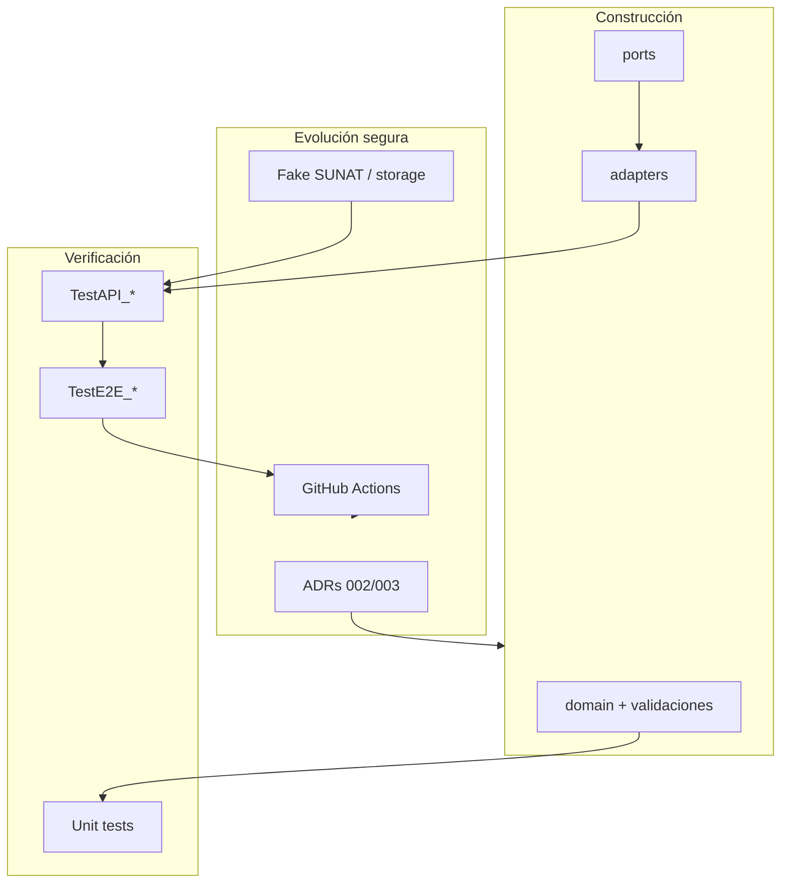

# Sesión 12: Refactorización Avanzada y Gestión de Deuda Técnica

**Universidad Nacional de Ingeniería (UNI) | SW707 Construcción de Software II**  
**Proyecto de referencia:** [FlowFacture](../README.md) — Grupo 4  

> *"Mejorar la estructura interna del código sin alterar su comportamiento observable."*  
> **Evolución | Mantenibilidad | Calidad de código**

---

## Portada transversal: FlowFacture como laboratorio

| Elemento | En el repositorio |
| :--- | :--- |
| Backend | Go 1.22 — `src/backend/` |
| Arquitectura | Monolito modular (`gestion` / `facturacion`) — [ADR 002](../docs/2/ADRS/002-monolito-modular.md) |
| Pruebas | **54** archivos `*_test.go`, documentados en [`tests/README.md`](../tests/README.md) |
| CI | 3 workflows: unitarios, API, E2E (`.github/workflows/`) |

**Mensaje de las sesiones 12 y 13:** primero construyes una **red de pruebas**; después refactorizas y evolucionas con confianza.

---

# PARTE A — SESIÓN 12

---

## Matriz de patología: olores de código (teoría)

### BLOATERS (código inflado)

- Clases o funciones gigantes, muchas responsabilidades (**violación SRP**).
- Síntoma típico: un solo archivo “hace de todo” (HTTP + SQL + SUNAT + PDF).

### OO ABUSERS

- `switch` / `if-else` enormes en lugar de polimorfismo o estrategias.
- Variación de comportamiento codificada como ramas en lugar de tipos.

---

## Olor detectado vs. decisión en FlowFacture

En un sistema tributario real conviven **emisión síncrona**, **cola outbox**, **worker asíncrono**, **SUNAT**, **PDF/XML** y **multi-tenant**.

**Decisión (ADR 002):** no un “god package”, sino:

```
internal/gestion/     → catálogo, clientes, usuarios, stock
internal/facturacion/ → emisión, UBL, ciclo de vida SUNAT
adapters/             → Postgres, Redis, R2/fs, Fake SUNAT, firma, PDF
internal/platform/    → HTTP, auth, config
```

| Olor teórico | Antídoto en el repo |
| :--- | :--- |
| Bloater monolítico | Bounded contexts + `ports` |
| Acoplamiento a SUNAT/DB | **Ports** (`internal/facturacion/ports`) + **adapters** |
| Parámetros sueltos | Structs de dominio (`Cliente`, `Producto`, `LineaCalculo`) |

---

## Catálogo Fowler ↔ ejemplos FlowFacture

| Técnica | Cómo aparece en el proyecto |
| :--- | :--- |
| **Extract Method** | Validación en `ValidarCliente`, `ValidarProducto`; cálculo en `domain.CalcularLinea` con pruebas dedicadas |
| **Introduce Parameter Object** | `Cliente`, `Producto`, `ConsultaPublicaCriteria` en lugar de listas largas de primitivos |
| **Replace Conditional with Polymorphism** | Puertos `SunatGateway`: implementaciones `Client` (SOAP) vs `Fake` según `NewFromConfig` |
| **Extract Interface (puerto)** | `StockPort`, `UnitOfWork`, `OutboxPublisher` — el dominio no conoce PostgreSQL |

**Compilación como red de seguridad estructural:**

```go
// adapters/postgres/adapters_test.go
var _ ports.UnitOfWork = (*UnitOfWork)(nil)
var _ ports.StockPort = (*Stock)(nil)
var _ ports.ComprobanteRepository = (*Comprobante)(nil)
```

Si un adapter deja de cumplir el contrato, **el build falla antes del runtime**.

---

## Deuda técnica — cuadrante Fowler

| | **Inadvertido** | **Deliberado** |
| :--- | :--- | :--- |
| **Prudente** | “Ahora sabemos que el outbox debía ir en la misma transacción” → [ADR 003](../docs/2/ADRS/003-outbox-postgres.md) | Monolito modular ahora; extraer microservicio **después** si el negocio lo exige |
| **Temerario** | Omitir pruebas en código nuevo | Desplegar contra SUNAT producción sin `Fake` en desarrollo |

**Ejemplo prudente deliberado:** `SunatGateway` **Fake** con modos `accept | reject | error` para no depender de la red en cada commit.

---

## Refactorización segura: la red de pruebas en FlowFacture

### Test Harness (arnés)

El paquete `internal/apitest` monta un servidor HTTP real (`httptest`), Postgres migrado, Redis de test y adaptadores **Fake** (almacenamiento en memoria, SUNAT configurable):

- `newHarness(t)` — migra, trunca tablas, protege DB demo `flowfacture`
- Seeds reutilizables: `SeedEmpresaAdmin`, `SeedEmisionReady`
- Helpers: `request`, `requireStatus`, `emitir`

> **Regla del curso:** *Refactorizar sin cobertura automatizada no es ingeniería, es adivinanza.*  
> En este repo, cualquier cambio en HTTP o emisión debe seguir pasando `TestAPI_*` y `TestE2E_*`.

### Characterization tests (legacy / integración)

Las pruebas de `apitest` **congelan el comportamiento observable** de la API: códigos HTTP, idempotencia de emisión, estados tras el worker, consulta pública, rate limit, etc. Eso permite cambios internos en handlers o repositorios sin alterar el contrato externo.

---

## Ciclo RED–GREEN–REFACTOR aplicado al flujo real

| Fase | Analogía en FlowFacture |
| :--- | :--- |
| **RED** | Agregar `TestAPI_ConsultaPublica_RateLimit429` antes de endurecer el middleware |
| **GREEN** | Implementar el contador en Redis hasta que pase |
| **REFACTOR** | Extraer lógica a un puerto o helper **con la suite verde en CI** |

Los workflows de GitHub Actions ejecutan las tres capas en cada PR:

| Workflow | Comando | Capa |
| :--- | :--- | :--- |
| `test-unit-backend.yml` | `go test ./internal/platform/auth/ ./internal/facturacion/domain/ ...` | Unitarios |
| `test-api-backend.yml` | `go test ./internal/apitest/ -run 'TestAPI_'` | Integración HTTP + DB |
| `test-e2e-backend.yml` | `go test ./internal/apitest/ -run 'TestE2E_'` | E2E (flujos completos) |

---

## Strangler Fig Pattern ↔ evolución del monolito modular

**Teoría:** envolver el legacy, redirigir tráfico gradualmente, retirar el núcleo viejo.

**FlowFacture (variante académica):**

1. **T1 — Núcleo en producción:** API + Worker + Postgres (un deployable).
2. **T2 — Intercepción por puertos:** `facturacion` habla con `StockPort`; el adapter Postgres puede sustituirse sin tocar reglas de emisión.
3. **T3 — Extracción futura:** ADR 002 deja explícito que `facturacion` **no importa** `gestion`; podría convertirse en servicio separado manteniendo el mismo contrato de puerto.

El **Transactional Outbox** ([ADR 003](../docs/2/ADRS/003-outbox-postgres.md)) es otro puente evolutivo: hoy relay en Postgres; mañana podría ser broker sin romper la escritura ACID en emisión.

---

## Análisis estático y refactor en la práctica

| Herramienta teórica | Estado en FlowFacture |
| :--- | :--- |
| IDE (rename, extract) | Go + editor; compilador estricto con interfaces |
| Linters / AST | `go vet`, convenciones de paquete |
| SonarQube / quality gates | **No integrado** — oportunidad de mejora en el pipeline |
| Contratos API | `docs/2/2-apis.md` + pruebas `apitest` como contrato ejecutable |

---

## Diagnóstico → refactor (ejemplo alineado al dominio)

### Olor (estilo “procesar_ordenes” del PDF)

Muchos parámetros sueltos y validación anidada en un solo flujo.

### Código actual (patrón ya aplicado)

```go
// internal/gestion/domain/producto.go (extracto)
func ValidarProducto(p Producto, stockInicial *int64) error {
    if strings.TrimSpace(p.Codigo) == "" {
        return fmt.Errorf("%w: codigo requerido", ErrInvalido)
    }
    // ... afectación, stock opcional, reglas SUNAT/catalogo
}
```

**Refactorizaciones ya visibles:**

1. **Parameter object:** struct `Producto`.
2. **Extract method:** validación aislada, probada en `producto_test.go`.
3. **Ramificación de afectación:** `switch` sobre constantes de dominio — candidato a estrategia si crece la complejidad tributaria.

---

## Reglas de oro de la refactorización (checklist Grupo 4)

1. **Nunca refactorices sin pruebas** — ejecutar al menos unitarios + capa tocada (`tests/README.md`).
2. **Pasos atómicos** — un commit, `go test`, siguiente cambio.
3. **Pagar deuda prudente** — documentar en ADR cuando el atajo fue deliberado.
4. **Código para humanos** — nombres en español en dominio/errores donde el negocio es local (SUNAT, IGV, series).

**Próxima estación:** Sesión 13 — Ingeniería de Verificación de Software.

---
---

# PARTE B — SESIÓN 13

---

## El eslabón crítico: construcción → evolución

| Fase | FlowFacture |
| :--- | :--- |
| **Construcción** | Puertos, transacciones, idempotencia, UBL 2.1 |
| **Verificación continua** | 54 suites Go, CI en 3 niveles, Fakes perimetrales |
| **Evolución segura** | Monolito modular + outbox; SUNAT real solo con credenciales |

---

## Estratigrafía de pruebas en el repositorio

**Costo y mantenimiento ↑** ————————— **Velocidad de feedback ↑**

```
                    ┌─────────────────────────────┐
  Peak (E2E)        │ TestE2E_*  (apitest)        │  Postgres + Redis + worker en proceso
                    ├─────────────────────────────┤
  Integration       │ TestAPI_* + adapters/*_test │  HTTP + DB / SOAP mockeado
                    ├─────────────────────────────┤
  Unit              │ domain/*_test, auth/*_test  │  Sub-ms, sin red
                    └─────────────────────────────┘
```

Fuente canónica: [`tests/README.md`](../tests/README.md)

| Capa | Paquetes ejemplo | Servicios |
| :--- | :--- | :--- |
| Unitarios | `internal/gestion/domain`, `internal/facturacion/domain`, `internal/platform/auth` | Ninguno |
| Integración adapters | `adapters/postgres`, `adapters/sunat`, `adapters/redis` | Postgres / Redis según test |
| API | `internal/apitest` (`TestAPI_*`) | Postgres + Redis |
| E2E | `internal/apitest` (`TestE2E_*`) | + procesador envío / Fake SUNAT |

**Convención local:** `go test ... -p 1` en integración para evitar carreras sobre la misma base.

---

## Anatomía FIRST en pruebas Go del proyecto

| Criterio | Evidencia en FlowFacture |
| :--- | :--- |
| **F – Fast** | `domain` tests ~2 ms (`money_test`, `cliente_test`) |
| **I – Independent** | `t.Parallel()` en `cliente_test.go`; harness con `TRUNCATE` por test |
| **R – Repeatable** | `DATABASE_URL` → DB descartable; `SUNAT_FAKE_MODE` determinista |
| **S – Self-validating** | `t.Fatal` / `requireStatus`; sin inspección manual |
| **T – Timely** | Pruebas junto a módulos (ej. `emitir` + `e2e_emitir_test.go`) |

---

## Patrón AAA — tres estilos en el mismo repo

### 1) Dominio puro (estado)

```go
// internal/facturacion/domain/money_test.go
func TestCalcularLinea_GravadoIGVIncluido(t *testing.T) {
    l := domain.LineaCalculo{Cantidad: 1, PrecioUnitario: decimal.RequireFromString("118.00"), ...}
    tot, err := domain.CalcularLinea(l)          // Act
    if err != nil { t.Fatal(err) }
    if !tot.IGV.Equal(decimal.RequireFromString("18.00")) { ... } // Assert
}
```

### 2) API con subtests (comportamiento + ramas)

```go
// internal/apitest/auth_api_test.go
func TestAPI_Login(t *testing.T) {
    t.Run("credenciales validas", func(t *testing.T) { /* Arrange: harness + seed; Act: POST; Assert: 200 + token */ })
    t.Run("credenciales invalidas", func(t *testing.T) { /* ... 401 */ })
    t.Run("usuario inactivo", func(t *testing.T) { /* ... UPDATE + 401 */ })
}
```

### 3) E2E (cadena de comportamiento)

`TestE2E_EmitirComprobante`: login → emitir → listar → re-POST idempotente → mismos IDs.

---

## Matriz de dobles de prueba ↔ implementación FlowFacture

| Tipo teórico | Pieza en el proyecto | Uso |
| :--- | :--- | :--- |
| **Dummy** | Certificado vacío → `firma.Fake` en tests (`NewFromPaths_FakeWhenEmpty`) | Ocupa el puerto sin cripto real |
| **Stub** | `Fake.ModeAccept` devuelve CDR prefabricado | Aserciones de **estado** post-envío |
| **Spy** | (No hay framework tipo Mockito; se usan Fakes + lectura de DB/HTTP) | — |
| **Mock** | `fake_test.go` verifica modos reject/error | Comportamiento esperado del gateway |
| **Fake** | `storage.Fake`, `sunat.Fake`, `pdf.Fake`, Postgres de test | Simulación operativa sin red/R2/SUNAT |

**Factory de ensayo:**

```go
// adapters/sunat/factory.go — sin credenciales → gateway Fake
if mode == "fake" {
    return GatewaySelection{Gateway: NewFake(Mode(cfg.SunatFakeMode)), Mode: "fake"}, nil
}
```

En el **harness** (`harness_test.go`) se inyectan `storage.NewFake()`, SUNAT fake y servidor HTTP completo — **cero acoplamiento a red** en CI.

---

## Motor TDD — caso real: worker + SUNAT

**RED (comportamiento deseado):** tras emitir, el worker debe dejar el comprobante en `ACEPTADO` cuando el gateway fake acepta.

**GREEN:** `ProcesadorEnvio.RunOnce` + adapter `sunat.Fake`.

**Evidencia (E2E):**

```go
// internal/apitest/e2e_worker_test.go (flujo resumido)
proc := h.newProcesadorEnvio(sunat.ModeAccept)
proc.RunOnce(ctx)
// GET comprobante → estado == "ACEPTADO"
```

**REFACTOR:** mover orquestación entre outbox, storage y gateway sin romper `TestE2E_EmitirYAceptarSUNATFake`.

---

## Cobertura: métrica y límites en este proyecto

| Métrica | En FlowFacture |
| :--- | :--- |
| **Line coverage** | No hay umbral publicado en CI (`go test` sin `-cover` en workflows) |
| **Branch coverage** | Cubierta **implícitamente** con `t.Run` (login válido/inválido/inactivo; SUNAT accept/reject/error) |
| **Contrato HTTP** | Tabla en `tests/README.md` (auth → reportes M7) |

### Ilusión de seguridad — advertencia para exposición

- Pasar **100 % líneas** no demuestra que el **IGV**, la **idempotencia** o el **outbox** sean correctos.
- Las aserciones deben validar **negocio** (ej. totales decimales en `money_test`, idempotencia en `e2e_emitir_test`).

**Recomendación de laboratorio (no implementada aún):**

```bash
go test ./... -coverprofile=coverage.out
go tool cover -func=coverage.out
```

---

## Pruebas de mutación — teoría vs. repo

| Concepto | Estado en FlowFacture |
| :--- | :--- |
| Mutante (`>` → `<` en `CalcularLinea`) | Detectable si `money_test` falla |
| Herramienta (`go-mutesting`, etc.) | **No configurada** |
| **Mutation score** | No medido — candidato para trabajo futuro del curso |

**Ejercicio conceptual:** mutar `ValidarCliente` para aceptar DNI de 7 dígitos; solo los tests que assertan `ErrInvalido` “matarían” el mutante.

---

## Laboratorio: aislamiento en Go (equivalente al ejemplo pytest del PDF)

| Producción | Prueba |
| :--- | :--- |
| `EmitirComprobante` usa `SunatGateway` vía puerto | `sunat.NewFake(ModeAccept)` en harness / `e2e_worker_test` |
| Persistencia R2/S3 | `storage.Fake` en memoria |
| Firma PKCS#12 | `firma.Fake` en tests API |

**Cero acoplamiento a red** + **validación de comportamiento exacto** (estado `ACEPTADO`, CDR almacenado, descargas HTTP en `descarga_api_test.go`).

---

## Mapa rápido `apitest` (diapositiva de cierre técnico)

| Archivo | Qué verifica |
| :--- | :--- |
| `auth_api_test.go` | Login / me / logout |
| `clientes_api_test.go` / `e2e_clientes_test.go` | CRUD clientes |
| `emitir_api_test.go` / `e2e_emitir_test.go` | Emisión e idempotencia |
| `e2e_worker_test.go` | Outbox → Fake SUNAT |
| `consulta_publica_api_test.go` | Token, 404, 410, 429 |
| `e2e_documentos_test.go` | Emitir → CDR → descargas → consulta pública |

---

## Reglas de oro de verificación (manifiesto Grupo 4)

1. **Aislar para dominar** — Fakes en `adapters/*` y harness; SUNAT real solo en entornos con credenciales (`ResolveSunatEndpoint`).
2. **Desconfiar del 100 % líneas** — priorizar ramas de negocio (auth, emisión, consulta pública) y pruebas E2E de flujo tributario.
3. **TDD como diseño** — los `ports` existen porque el worker y la API deben sustituir SUNAT/Postgres en test sin `#ifdef`.

**Próxima estación (Semana 14):** Evolución del software — extraer límites del monolito modular, endurecer observabilidad y mutation testing.

---

## Diapositiva final — un solo diagrama mental



---

## Referencias rápidas para exponer

- Documentación de pruebas: [`tests/README.md`](../tests/README.md)
- Arquitectura C4: [`docs/2/1-arquitectura.md`](../docs/2/1-arquitectura.md)
- Backend (seed, worker): [`src/backend/README.md`](../src/backend/README.md)
- Ejecutar suite M7 (PC / demo local): sección “Suite M7 recomendada” en `tests/README.md`

*Documento generado para exposición SW707 — Sesiones 12 y 13, anclado al estado actual del repositorio FlowFacture.*